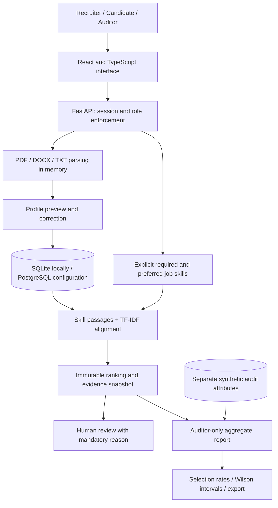

# Evaluation guide

## Project introduction
Candidate Lab connects a job's explicit skill requirements to evidence in a candidate profile. Recruiters inspect the score and source passages before recording their own review. Auditors inspect separate aggregate cohort comparisons. The application supports accountable screening research; it does not autonomously employ or reject people.

## Problem and proposed solution
Manual resume screening is difficult to reproduce. Keyword searches can miss aliases, opaque rankings hide their reasoning, and historical hiring labels may reflect prior disadvantage. This implementation makes a small matching rubric visible, records its evidence and versions, separates audit attributes from scoring, and leaves decisions with a reviewer. These controls improve inspectability; they do not establish that a system is fair in deployment.

## Implemented architecture

Both default extraction and matching execute locally. No external resume API or LLM is called. Optional local Sentence Transformers inference is configurable, but was not enabled in this verified baseline.

## Stack and component responsibilities
| Component | Technology | Responsibility |
|---|---|---|
| Frontend | React, TypeScript, Vite | Forms, evidence ledger, review workspace, audit controls |
| API | FastAPI, Pydantic | Input validation, session and role boundaries, endpoints |
| Persistence | SQLAlchemy, SQLite | Jobs, profiles, versions, snapshots, decisions, audit events |
| Optional deployment | PostgreSQL, psycopg, Docker Compose | Private containerized deployment configuration |
| Extraction | pypdf, python-docx, dictionary aliases | Read documents, identify skill passages, allow correction |
| Matching | scikit-learn TF-IDF and cosine similarity | Experimental text alignment plus explicit skill coverage |
| Audit | Python arithmetic | Synthetic-cohort rates, Wilson intervals, suppression |
| Verification | pytest, HTTPX TestClient, Playwright | API integration and real-browser journeys |

## A five-minute demonstration
1. Start with `start.ps1` and open http://127.0.0.1:8000. Choose recruiter and sign in.
2. Show a seeded job's required and preferred skills. Explain that the description is context; the explicit skills define the scoring rubric.
3. Add a profile using `examples/resume.txt`. Show extraction, correct text, and save. No demographic fields are requested.
4. Run matching. Open Evidence and show how the three contributions add up. Read one requirement and its supporting passage. A mentioned skill is evidence to investigate, not proof of competence.
5. Enter a job-related reason and save a human review. The review label does not change the numerical score.
6. Correct a profile, then reopen the old snapshot. Its original evidence version stays unchanged.
7. Sign in as auditor. Explain arbitrary synthetic Cohort A/B labels, adjust the shared cutoff, inspect sample sizes and intervals, and export JSON.
8. Sign in as candidate. Only the candidate's owned profiles are visible; ranking and audit access is blocked by the server.

## Scoring model card
**Default method:** skill-tfidf-v1. Required skill coverage contributes 60 points, preferred coverage 15, lexical alignment up to 25. Without preferred skills the split becomes 75/0/25. Exact contribution terms are shown; they are not SHAP values. The vocabulary and aliases are in `backend/matching.py`.

**Inputs:** confirmed recognized skill-bearing passages and explicit job requirements. Contact/identity headers are filtered heuristically. Audit attributes are never passed to the matcher. Identity can remain embedded in prose; the filter is not complete anonymization. Negation, exaggeration and contextual proficiency are not reliably understood by dictionary extraction.

**Output:** a matching index, source passages, warnings and an immutable profile-version snapshot. The index is not a calibrated probability. TF-IDF is fitted to each run's query and candidate corpus, so adding profiles may change alignment scores. Compare saved snapshots with their cohort and method context.

**Training status:** no real labelled dataset supplied, no trained hiring-outcome classifier, no measured real-world accuracy or demographic fairness. All seeded profiles and cohort labels are synthetic. The default model has no remote dependency. Optional local semantic embeddings require separate installation, licensing and evaluation.

**Audit limits:** groups smaller than five have rates suppressed. A common threshold simulates selection for research only. Wilson intervals express uncertainty in each rate; they do not prove the system safe or unbiased. Arbitrary A/B labels do not establish demographic parity in a real population. Without qualification labels, equalized odds and error-rate fairness cannot be evaluated.

## Next research stage
Obtain consented resume-job relevance annotations under a documented rubric, using multiple annotators and agreement measurements. Split by candidate and job family to prevent leakage. Compare simple lexical, semantic and supervised baselines using ranking metrics such as NDCG@k and recall@k, with confidence intervals. Evaluate extraction quality and negation errors separately. Measure approved cohort gaps on a held-out population before considering mitigation. Document the relevance/fairness tradeoff and preserve human oversight.

Before an organizational deployment, add identity provisioning, retention/deletion workflows covering historical snapshots, database migrations, isolated document parsing, operational monitoring, and security review. Docker/PostgreSQL and the optional semantic path are configuration support, not verified deployments in this workspace.
